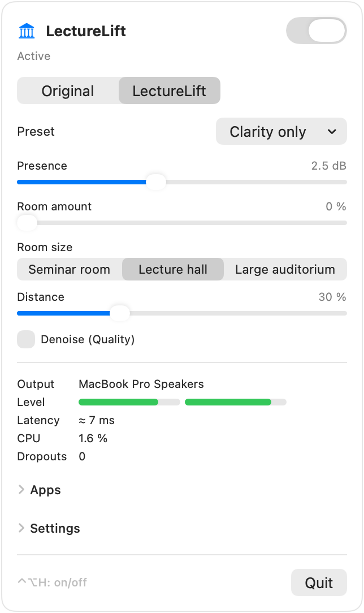
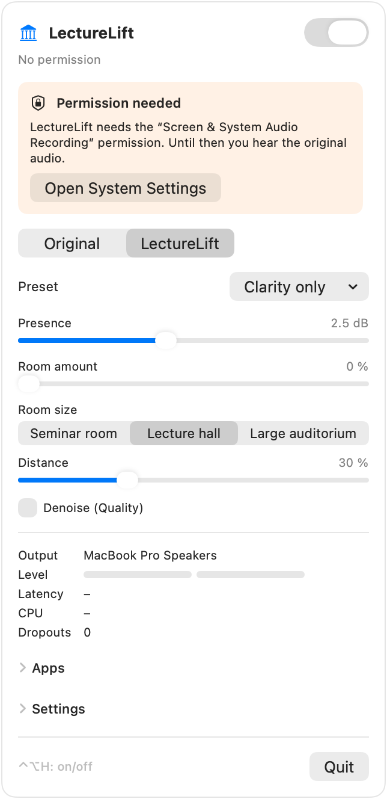
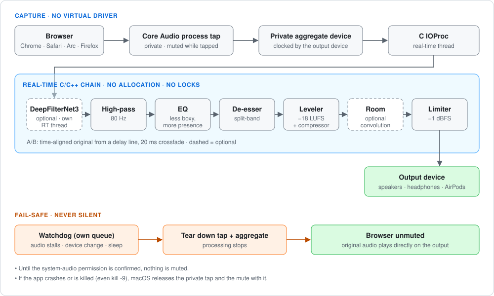

# LectureLift

 [](https://github.com/aetsr/lecturelift/actions/workflows/ci.yml) 

> **Project status: frozen.** LectureLift works and is published as-is. It is not actively developed;
> issues and pull requests may not get a response. Forks are welcome (MIT).

**Clearer, steadier lecture audio on your Mac, live and per app, with no virtual audio driver.**

LectureLift is a small macOS menu-bar app that processes the sound of your browser while you watch recorded
lectures (Moodle, Zoom/Teams recordings, any video in the browser). Speech gets clearer and the level
stays even. Music, calls and every other app stay untouched.

<table align="center">
  <tr>
    <td align="center"><picture><source media="(prefers-color-scheme: dark)" srcset="docs/images/menu-dark.png"></picture></td>
    <td align="center"><picture><source media="(prefers-color-scheme: dark)" srcset="docs/images/permission-dark.png"></picture></td>
  </tr>
  <tr>
    <td align="center"><sub>Active: A/B switch, preset, sliders, meters</sub></td>
    <td align="center"><sub>First run: permission prompt (nothing is muted yet)</sub></td>
  </tr>
</table>

## Why

Recorded lectures often sound bad: a laptop or headset mic, the meeting software's noise suppression and
codec, a boomy room, a lecturer who walks away from the mic. System EQ apps need a virtual audio driver and
process *everything*; noise-removal tools are made for your microphone, not for what you listen to.
LectureLift taps only the apps you choose and runs a speech-oriented chain on them in real time.

## What it does (honestly)

- **"Nur Klarheit / Clarity" (default):** 80 Hz high-pass, corrective EQ (less boxiness, more presence),
  a split-band de-esser, a speech leveler to −18 LUFS, and a −1 dBFS limiter.
- **A/B switch** ("Original | LectureLift"): instant, time-aligned, click-free comparison.
- **Optional denoising ("Qualität / Quality"):** DeepFilterNet3 on its own real-time thread. Removes noise
  and some room reverb; costs about 9–12 % of one performance core (M1, offline benchmark) and about 60 ms of
  processing latency.
- **Optional room presets** (seminar room / lecture hall / auditorium): convolution reverb with synthetic
  impulse responses.

**What the listening tests showed.** On real lecture recordings (already noise-suppressed by the meeting
software, recorded with a laptop/camera mic) the Clarity chain is clearly better than the original:
more intelligible, steadier level. But it is *not* a dramatic transformation.

- Adding room sound made things worse.
- Strong denoising also attacked the voice.

LectureLift improves tonality, level and (optionally) noise. It **cannot restore** what the recording
already lost: distance, the room, codec artefacts. Details: [`docs/DIAGNOSIS_CLIP1.md`](docs/DIAGNOSIS_CLIP1.md).

## Why it's technically interesting

<p align="center"></p>

- **Per-app capture with Core Audio process taps** (`CATapDescription`, macOS 14.4+). No BlackHole, no kernel or
  driver extension. The original audio of the tapped app is muted while LectureLift plays the processed
  version through a private aggregate device clocked by your output device.
- **Real-time-safe C/C++ chain.** The audio I/O callback does no allocation, no locks, no Swift/ObjC and no
  logging. Everything is prepared up front, parameters are atomics, and objects are swapped through lock-free
  queues. Two-stage FFT convolution (FFTConvolver + vDSP) runs synchronously with staggered tail jobs.
- **Never-silent fail-safe design:**
  - Until the system-audio permission is confirmed, the browser is not muted.
  - A watchdog tears the tap down if audio stalls, and the original sound comes back. Process death
    (even `kill -9`) also releases the mute; verified on macOS 27.2 (`docs/DECISIONS.md`, D-007).
  - Device changes, Bluetooth rate changes and idle periods are handled by a debounced reconcile with
    generation numbers.
- **DeepFilterNet3 on its own time-constraint thread.** It joins the device's audio workgroup and feeds SPSC
  rings with a fixed latency. If it falls behind, the audio crossfades to an equally delayed copy of the
  input. libDF is loaded at runtime (`dlopen`), so the app builds without Rust.
- **Offline renderer** (`lecturelift-render`) runs the exact same chain on WAV files for tests, benchmarks and
  A/B listening sets.
- **85 unit tests** (the denoiser tests need libDF; the snapshot test is skipped on CI), among them:
  - bit-exact bypass;
  - partitioned vs direct convolution;
  - RT60 of the synthetic rooms;
  - limiter needs no clipping;
  - leveler stability;
  - denoiser stall recovery;
  - UI snapshot rendering;
  - de/en string completeness.

The full design and every decision, including independent design reviews, are in [`docs/`](docs).

## Install

Requirements: **macOS 14.4 or later, Apple Silicon.**

**Download:** [**LectureLift.dmg** (latest release)](https://github.com/aetsr/lecturelift/releases/latest/download/LectureLift.dmg)
· [all releases](https://github.com/aetsr/lecturelift/releases)

The app is **ad-hoc signed and not notarized**. After dragging it to Applications, open it
once (macOS blocks it), then go to System Settings → Privacy & Security → **Open Anyway**. On macOS 14,
*right-click → Open* also works. Alternatively:

```sh
xattr -dr com.apple.quarantine /Applications/LectureLift.app
```

**Build from source:**

```sh
git clone https://github.com/aetsr/lecturelift.git && cd lecturelift
./scripts/build_libdf.sh           # optional: the denoiser (needs rustup; pinned toolchain); run before build.sh
./scripts/build.sh                 # → build/LectureLift.app and build/LectureLift.dmg (needs Xcode / Swift 5.10+)
open build/LectureLift.app
```

`build.sh` signs with an "Apple Development" identity from your keychain if present (then the audio-capture
permission survives rebuilds), otherwise ad hoc (macOS then asks again after every rebuild).

**First launch:**
1. Click the 🏛 icon in the menu bar and switch LectureLift **on**.
2. macOS asks for **"Screen & System Audio Recording"**. Allow it.
3. Play a lecture in Chrome, Safari, Arc or Firefox. Pick other apps under "Apps". ⌃⌥H toggles LectureLift.

The UI is German (default) and English (follows the system language).

## Comparing before and after

The A/B switch compares live. For a careful listening test, *Settings → Record 60 s of original audio* saves
60 s of the unprocessed input to `~/Music/LectureLift Clips` (never uploaded); `scripts/make_listening.sh
CLIP.wav OUTDIR` then renders loudness-matched versions of every preset with the same chain as the app.

The screenshots in this README are rendered from the real SwiftUI view with test data:
`LECTURELIFT_DOC_IMAGES=1 swift test --filter DocImages` regenerates them (no audio involved).

## Known limitations and untested items

- **Not verified live yet:** sleep/wake while playing, `coreaudiod` restart, the onboarding flow with the
  permission *denied* (the code paths exist and are unit-tested where possible).
- The denoiser only runs at a 48 kHz output rate (44.1 kHz devices: Clarity only).
- Browsers' own per-tab output-device selection is not followed (LectureLift uses the system default output).
- Not notarized; no Developer ID signing.
- Uses one private API, the responsible-process lookup, to map Safari's audio process to Safari. That rules
  out the Mac App Store.

## Help wanted

The project is frozen, so these are open ends for anyone who forks it:

- Testing on other Macs and output devices (USB DACs, monitors, AirPods/Bluetooth HFP switching).
- Sleep/wake and `coreaudiod`-restart reports (`scripts/m1_live_tests.sh sleepwake|coreaudiod`; plays a quiet
  test tone and builds its helper tool automatically).
- Listening feedback on different lecture recordings: headset mics vs laptop mics, German and English.
- A proper app icon. The SF Symbol is only used in the menu bar.
- Notarized release builds (needs a Developer ID).

## Ideas (not planned; the project is frozen)

- **Offline restoration mode** (not started): generative speech restoration could do what real time cannot:
  dereverberate and "re-record" a distant voice. The best open candidate is **Sidon** (MIT, multilingual);
  WPE dereverberation would be a low-risk baseline. See [`docs/OFFLINE_RESEARCH.md`](docs/OFFLINE_RESEARCH.md).
- Adaptive corrective EQ that measures the lecturer's spectrum (see `docs/DIAGNOSIS_CLIP1.md`).

## Contributing

See [CONTRIBUTING.md](CONTRIBUTING.md). Please read the real-time rules before touching `Sources/HSCore`.

## Credits and licenses

MIT. See [LICENSE](LICENSE). Third-party components, all permissive; full texts in
[THIRD_PARTY_NOTICES.md](THIRD_PARTY_NOTICES.md) and [THIRD_PARTY_NOTICES_RUST.md](THIRD_PARTY_NOTICES_RUST.md):

- [FFTConvolver](https://github.com/HiFi-LoFi/FFTConvolver) (MIT), vendored.
- [DeepFilterNet](https://github.com/Rikorose/DeepFilterNet) / [DeepFilterNet Plus](https://github.com/ismailivanov/DeepFilterNetPlus)
  and the DFN3 weights (MIT OR Apache-2.0), optional, built by `scripts/build_libdf.sh`.
- Patterns from [AudioCap](https://github.com/insidegui/AudioCap) (BSD-2-Clause).

Prior art that informed the design (no code used): FineTune, tap-n-filter, catap, eqtune; see
[`docs/PRIOR_ART.md`](docs/PRIOR_ART.md).

This project was built with Claude Code (Anthropic) as the implementing agent, with the owner deciding
direction and doing the listening tests; the decision log in `docs/DECISIONS.md` documents that process.
